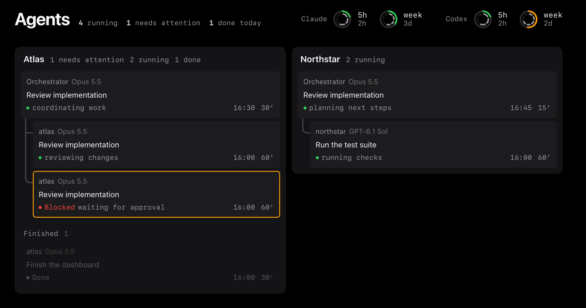

# Murmuratio

Version **0.3.0-beta**. A local macOS board for Claude Code and Codex, together or separately. See orchestrators and workers grouped by project, with tasks, recorded models and effort, inferred status, context and usage limits.



Beta software, provided as is. You are responsible for your data and your agents' actions. See [LICENSE](LICENSE) and [SECURITY.md](SECURITY.md).

## Install and run

Requires macOS and Python 3.11 or newer. The application uses only the Python standard library.

```sh
git clone https://github.com/damirsalakhovhub/murmuratio.git
cd murmuratio
```

Choose one lifecycle. Keep the cloned folder while installed. `--dry-run` previews installation and active data paths; `./murmuratio doctor` checks local sources. Try sample data without installing with `./murmuratio run --demo`.

### Foreground

```sh
./murmuratio install
./murmuratio run  # http://127.0.0.1:8765/
```

After updating the checkout, run the comparison below while the old board is still running. If it passes, stop the foreground server with Ctrl-C and run `./murmuratio run` again. Stop it before `./murmuratio uninstall`.

```sh
./murmuratio check-update --url http://127.0.0.1:8765
```

### LaunchAgent

```sh
./murmuratio install --launch-agent  # starts immediately and at login
```

After updating the checkout, compare and restart the installed service:

```sh
./murmuratio check-update --url http://127.0.0.1:8765 &&
  launchctl kickstart -k "gui/$(id -u)/org.murmuratio.app"
```

`./murmuratio uninstall` unloads the service and restores the previous status line. It removes owned installation files, the limits cache and unchanged installer-created configuration; edited configuration and derived history remain. Cache cleanup can be retried after a file-access failure.

Use the running board's URL and `--config` value for comparisons. `CODEX_HOME` selects the Codex data directory for both `run` and `check-update`; export the same value for each. The installed LaunchAgent uses the launchd environment and does not capture terminal variables; use the foreground lifecycle for a custom terminal environment. The comparison blocks unexplained card losses, changed roles/statuses and new or changed failures in card sources (Claude Desktop, Claude sessions, Codex sessions, Codex wrapper and agents registry). Quota and usage source health is outside this comparison. An unchanged pre-existing card-source failure does not block the update. It reads API data without printing task text or writing snapshots; it does not verify browser rendering. Source files can still change during the check.

## Exact links (optional)

Get exact parent links, titles and roles when Claude coordinates Codex, Codex coordinates Claude, or either coordinates its own kind.
Run `./murmuratio install --integrations` to add Claude hooks and its orchestration skill; plain `install` keeps its existing behavior (`--statusline` also enables the status line before Claude is set up).
Paste the printed block into your Codex `AGENTS.md` yourself. Codex sessions use `spawn` and this block; no Codex hooks are installed or files edited.
Register the caller with `./murmuratio agent register --kind claude --id "$CLAUDE_CODE_SESSION_ID" --role orchestrator --name "Project orchestrator"` (for Codex, use `--kind codex --id "$CODEX_THREAD_ID"`).
Launch with `./murmuratio spawn --to codex --title "Review parser" --model MODEL --effort LEVEL --parent-kind claude --parent-id "$CLAUDE_CODE_SESSION_ID" brief.md`; reverse the providers and use `$CODEX_THREAD_ID` for a Codex caller.
Supply the caller's actual ID; missing IDs fail visibly. Native Claude subagents use the hook-provided session/agent IDs with `--subagent-id` and `--parent-subagent-id`.
The local `~/.local/share/murmuratio/agents.jsonl` (0600) stores IDs, links, titles, role, folder, times, process identity, model/effort and exit status, never briefs, replies or hook payloads.
Requested model/effort stay separate from effective values observed in provider records; unknown effective values remain unknown. The configured legacy registry (default `~/.claude/tools/agents-registry.jsonl`) and wrapper records still work.
Allow registry writes and provider network access in the calling sandbox. Provider permissions keep their defaults; optional `--sandbox read-only|workspace-write` applies to Codex and `--permission-mode manual|acceptEdits|dontAsk|plan` to Claude.
Without integrations, the board keeps its existing inference; the word “orchestrator” in titles is a fallback. Stub tests cover four launch directions; live-provider parity is not established for every app/subagent environment.
Remove with `./murmuratio uninstall`: it restores settings, removes owned hooks/skill/metadata and preserves user edits or conflict backups. Add `--keep-integration-data` to retain the owned registry; remove pasted Codex instructions yourself.

## The board

- Named or registered orchestrators stay visible without children. Other top-level chats appear while they have an unfinished child or a child finished today. Identified Codex workers and recorded child sessions appear independently. An empty board means no eligible agents were found; a plain chat alone stays hidden.
- Native Claude subagents have separate worker cards below their parent. Finished workers remain visible for 30 minutes; today's completed work still contributes to totals. An unfinished Codex worker stays however long it is quiet. Sessions need saved provider records or explicit integration metadata to appear.
- Launcher titles appear verbatim. Other names prefer Desktop titles, then registry names, wrapper titles, subagent descriptions and meaningful task text (Claude's first prompt or Codex's latest user task). Models and effort come from saved records; unknown values stay unknown.
- Unfinished cards signal high context at 80%. Set `[board] context_high_percent = 80` to change the threshold (1–100). The board has no chat viewer or context-reset controls.
- Status, duration, parent matching and context are inferred from saved data. Exact parent IDs win; a unique folder/time match is marked inferred. Silence is not approval. Stale quota samples retain their age; a header line identifies old board snapshots.
- Missing providers have no limits display. Calculator appears when Codex quota or credit data is available; it is hidden in demo mode.

## Local data and trust

The server binds only to `127.0.0.1`. There is no access token: **any process or account on the same Mac can read `/api/now`, including session text. Do not run on shared machines.** Host and origin checks do not authenticate local users.

Default reads: Claude transcripts and subagents in `~/.claude/projects/`, Claude Desktop metadata in `~/Library/Application Support/Claude/claude-code-sessions/`, Codex rollouts and thread titles under `~/.codex/`, the owned registry at `~/.local/share/murmuratio/agents.jsonl`, the legacy registry at `~/.claude/tools/agents-registry.jsonl`, and the Claude limits cache at `~/.local/share/murmuratio/claude-limits.json`. macOS `lsof` checks inactive Codex rollout writers. Very large records are bounded or skipped.

Install creates `~/.config/murmuratio/config.toml` if absent and records/backups under `~/.local/share/murmuratio/install/`. If `~/.claude` exists, it wraps `statusLine` in `~/.claude/settings.json`, preserving the previous command; otherwise it skips that step. Install again after adding Claude to enable it. The wrapper writes only the Claude limits cache. Murmuratio never edits Codex chats or settings; SQLite may create WAL/SHM sidecars, and the Codex CLI can update its own state.

Normal inspection sends nothing off the machine. Existing status-line commands can have their own network activity. Browser preferences stay in local storage. Inspect the complete active inventory with `./murmuratio run --dry-run`.

## Optional modules

All seven modules start off. Enable them under `[modules]` in the configuration and restart:

- `forecast` estimates weekly quota pace; `scenarios` compares worker allocation and requires `forecast`.
- `routing` writes tool/model suggestions every minute; `codex_credits` shows credits and `burn_rate` shows usage rates.
- `codex_wrapper` reads compatible wrapper records; `branding` adds board graphics.

Forecast/routing write `limits-history.jsonl` under `~/.local/share/murmuratio/`; routing also writes `routing.json` and changed advice in `routing-history.jsonl`. Burn-rate calculations can read quota history. Paths, project mappings, work hours and routing policy are configurable; see [Architecture](docs/ARCHITECTURE.md).

Codex normally reports limits only while it works. Optional `[limits] codex_live = true` starts `codex app-server` every five minutes for `account/rateLimits/read`, with earlier reads at known resets. Codex contacts OpenAI with your signed-in account; no model call is made. Set `[paths] codex_cli` to choose its executable.

Murmuratio is not affiliated with Anthropic or OpenAI. Claude, Claude Code and Codex are their respective owners' trademarks. Usage and context estimates are not billing records.

[Changelog](CHANGELOG.md), [Security](SECURITY.md), [Contributing](CONTRIBUTING.md), [Tests](tests/README.md), [MIT license](LICENSE).
